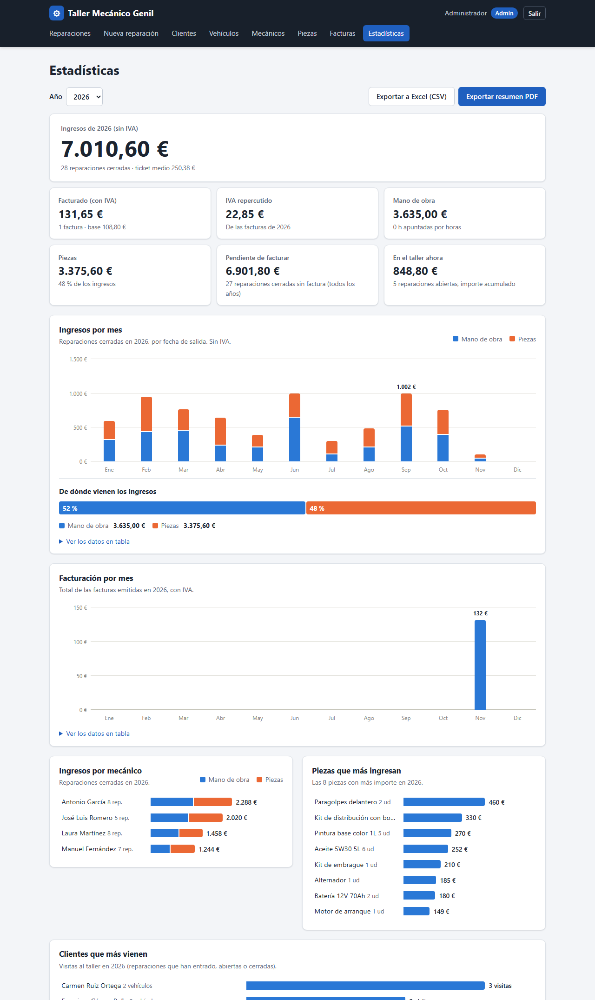
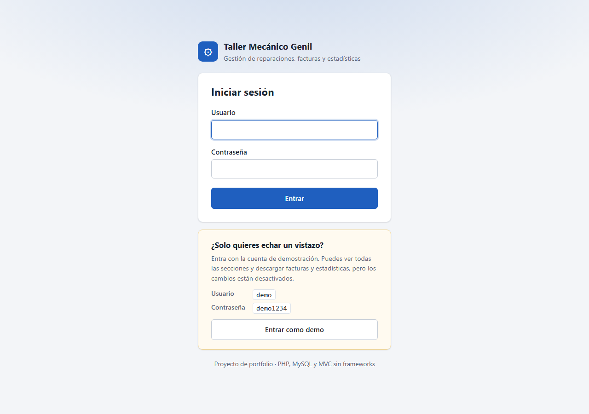
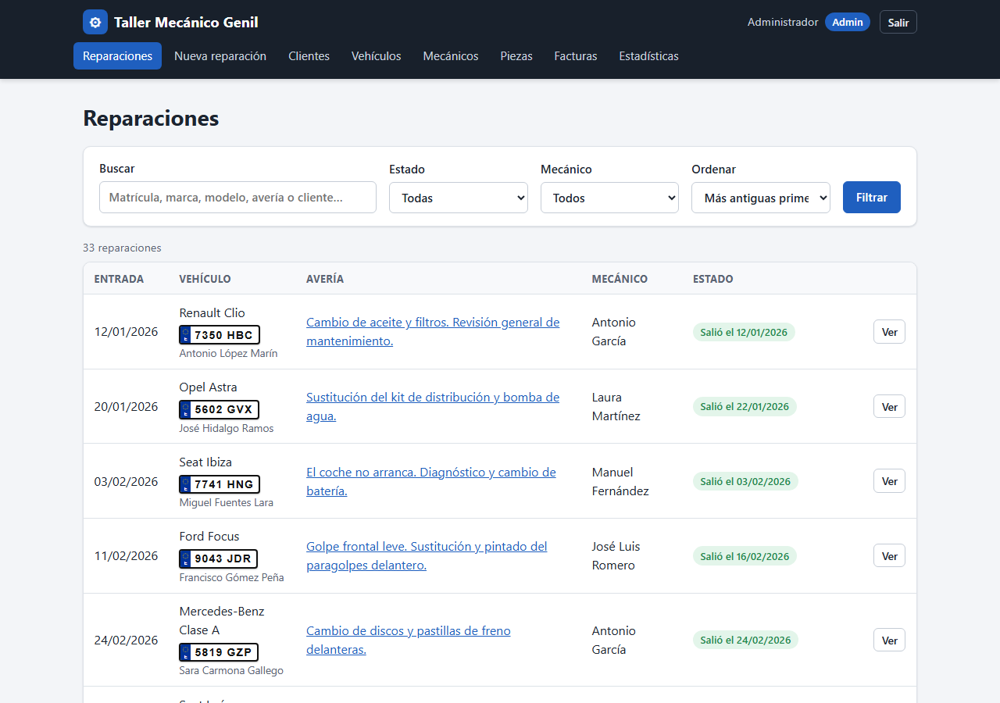
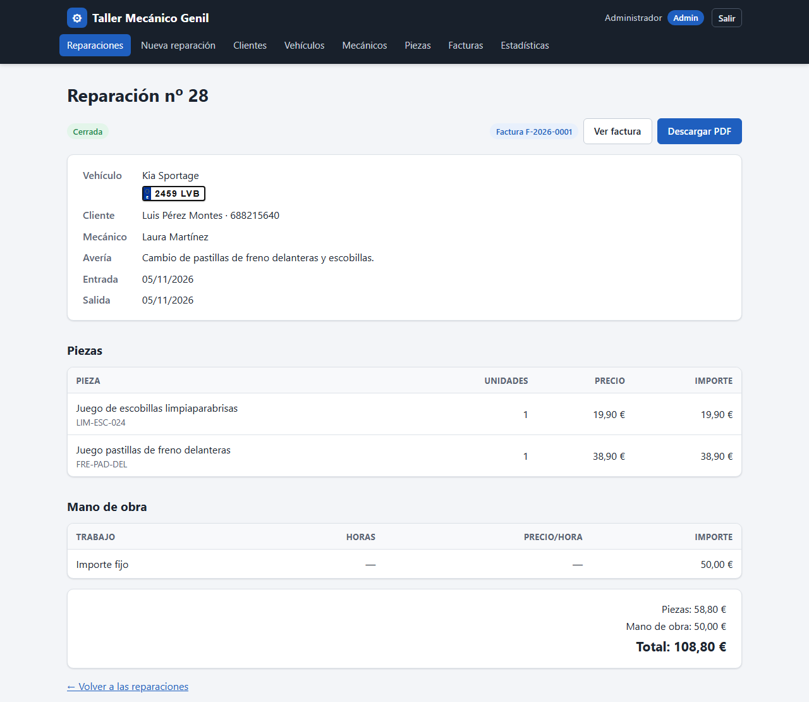
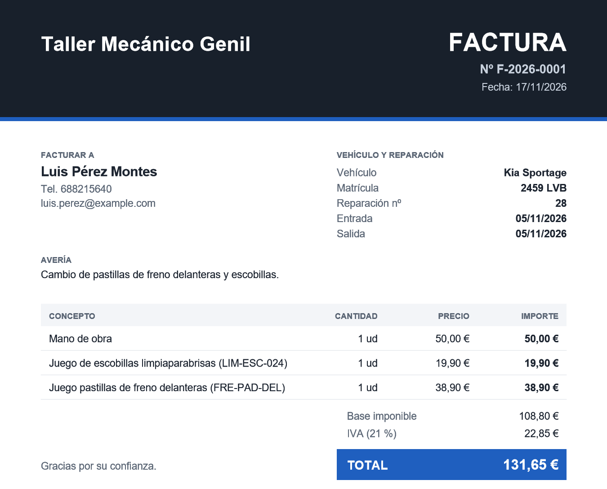
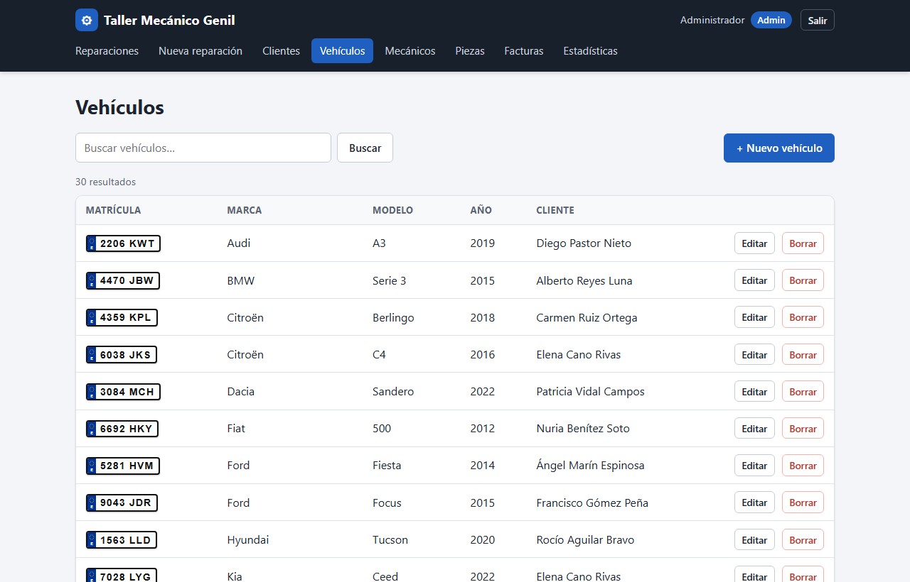
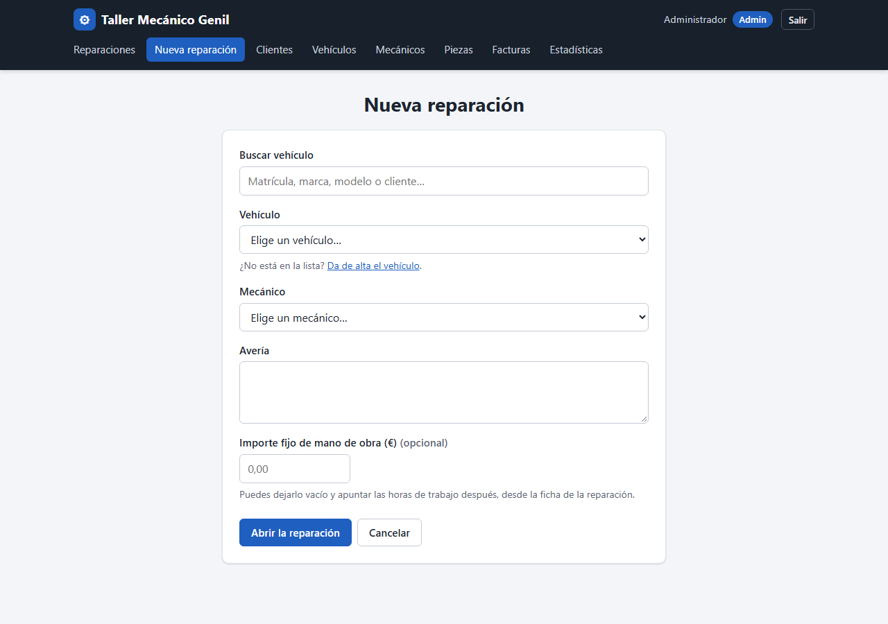
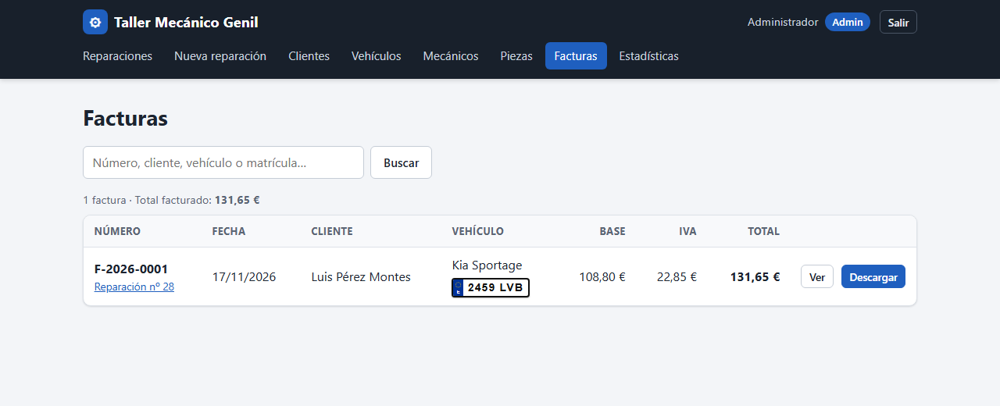

<div align="center">

# ⚙️ Taller Mecánico Genil

**Aplicación web para gestionar un taller mecánico: reparaciones, piezas, mano de obra, facturas en PDF y estadísticas de ventas.**

Hecha en PHP puro con arquitectura MVC, sin frameworks ni librerías externas.




</div>

---

## 👀 Cuenta de demostración

La aplicación tiene una cuenta **demo de solo lectura** pensada para quien quiera curiosear: se puede ver todo y descargar facturas y estadísticas, pero guardar, editar y borrar están desactivados (también en el servidor, no solo en la interfaz).

| Usuario | Contraseña |
|:-------:|:----------:|
| `demo`  | `demo1234` |

Los datos que aparecen son ficticios.

## ✨ Funcionalidades

### 🔧 Reparaciones
- Alta de reparaciones con buscador de vehículos dentro del desplegable.
- Listado con **filtros** (en el taller / cerradas, mecánico), **buscador** (matrícula, marca, modelo, avería o cliente) y varios **órdenes**; por defecto, las que siguen en el taller arriba.
- Ficha de cada reparación: añadir y quitar **piezas** (si se repite una pieza se suman las unidades) y **mano de obra por horas**.
- **Cerrar** la reparación (pone la fecha de salida); una vez cerrada ya no se toca.

### 🧾 Facturas en PDF
- Factura con **numeración correlativa por año** (`F-2026-0001`…), base imponible, IVA y total.
- Guarda una **copia fija** de los datos: si después cambia el precio de una pieza o los datos de un cliente, la factura emitida no cambia.
- PDF generado con un **generador propio** ([`lib/Pdf.php`](lib/Pdf.php)), sin librerías: tildes, ñ, €, saltos de página y «Página X de Y».

### 📊 Estadísticas
- Ingresos y facturación por mes, reparto mano de obra / piezas, ingresos por mecánico, piezas que más ingresan y **clientes que más vienen**.
- Lo pendiente de facturar y lo que hay ahora mismo en el taller.
- Gráficas hechas con **HTML y CSS** (sin librerías), con ventana emergente accesible con teclado y tabla de datos alternativa. Colores validados para daltonismo.
- **Exportación** a Excel (CSV en formato español) y a **PDF**.

### 🗂️ Gestión
- Alta, edición, baja y búsqueda de **clientes, vehículos, mecánicos y piezas**, con validación de cada campo.
- No deja borrar lo que está en uso (un cliente con vehículos, una pieza usada en una reparación…).

### 🔐 Usuarios y roles
- Login con roles **admin** (todo) y **demo** (solo lectura).

## 📸 Capturas

| Inicio de sesión | Listado de reparaciones |
|:---:|:---:|
|  |  |
| **Ficha de una reparación** | **Factura en PDF** |
|  |  |
| **Gestión de vehículos** | **Nueva reparación** |
|  |  |
| **Facturas** | |
|  | |

## 🛡️ Seguridad

- **Consultas preparadas** (PDO) en todo el SQL. Donde un nombre de tabla, columna u orden no puede ir como parámetro, sale de una **lista cerrada**, nunca de la petición.
- **Escapado** de toda la salida HTML (`htmlspecialchars`) y de los textos de las gráficas (`textContent`).
- Contraseñas con **`password_hash` / `password_verify`** (bcrypt), con rehash automático.
- Sesión con cookie **`HttpOnly`** y **`SameSite=Lax`**, id de sesión nuevo al entrar y **freno a la fuerza bruta** (5 intentos → 60 s de espera).
- Mismo mensaje de error exista o no el usuario, y mismo tiempo de respuesta.
- Las acciones que cambian datos solo aceptan **POST**; la cuenta demo tiene **todos los POST bloqueados** en el servidor.
- Las operaciones de varias consultas (crear una factura) van en **transacción**.

## 🏗️ Arquitectura

Patrón **MVC** con un controlador frontal (`index.php`) que recibe todas las peticiones y las reparte con `match`.

```
taller-mecanico/
├── index.php                 # Controlador frontal: sesión, control de acceso y rutas
├── config/
│   ├── conexion.php          # Conexión PDO
│   ├── config_example.php    # Plantilla de credenciales → copiar a config.php
│   └── empresa.php           # Datos del taller e IVA para las facturas
├── controladores/            # Reciben la petición, validan y eligen la vista (sin SQL ni HTML)
├── model/                    # Todo el SQL vive aquí
├── vistas/                   # Plantillas HTML, CSV y PDF
├── lib/
│   ├── Pdf.php               # Generador de PDF propio
│   └── Sesion.php            # Sesión, roles y avisos
├── js/app.js                 # Buscador de desplegables, confirmaciones, tooltips y modo demo
├── estilos.css               # Diseño completo (variables CSS, responsive)
└── docs/capturas/            # Imágenes de este README
```

## 🚀 Instalación en local

**Requisitos:** PHP 8.1 o superior (con `pdo_mysql` y `mbstring`) y MySQL 8 / MariaDB. Vale con XAMPP, Laragon o similar.

1. Clona el repositorio en la carpeta de tu servidor:
   ```bash
   git clone https://github.com/IamYisuSB/taller-mecanico.git
   ```
2. Copia la plantilla de configuración y pon tus credenciales:
   ```bash
   cp config/config_example.php config/config.php
   ```
3. Crea la base de datos `taller`. **La base de datos no se incluye en el repositorio**; la aplicación usa estas tablas: `clientes`, `vehiculos`, `mecanicos`, `piezas`, `reparacion`, `piezas_reparacion`, `mano_obra_reparacion`, `facturas`, `factura_lineas` y `usuarios`.
4. Rellena los datos del taller (NIF, dirección…) en [`config/empresa.php`](config/empresa.php).
5. Abre `index.php` en el navegador.

> Para crear o cambiar la contraseña de un usuario, genera el hash con
> `php -r "echo password_hash('tu-contraseña', PASSWORD_DEFAULT), PHP_EOL;"`
> y guárdalo en la columna `contrasena` de la tabla `usuarios`.

## 👤 Autor

Hecho por **[IamYisuSB](https://github.com/IamYisuSB)** como proyecto de portfolio.
